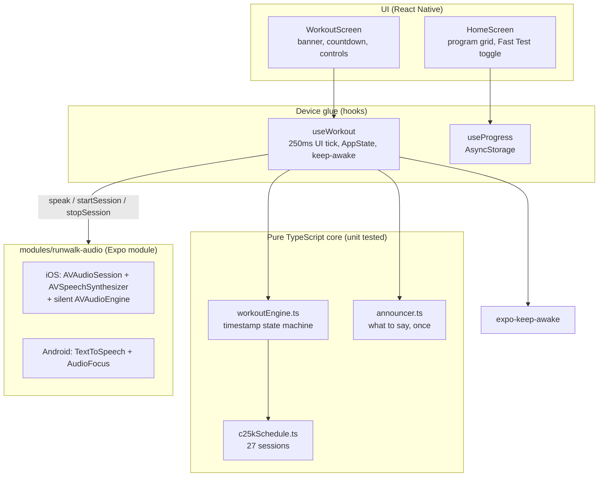
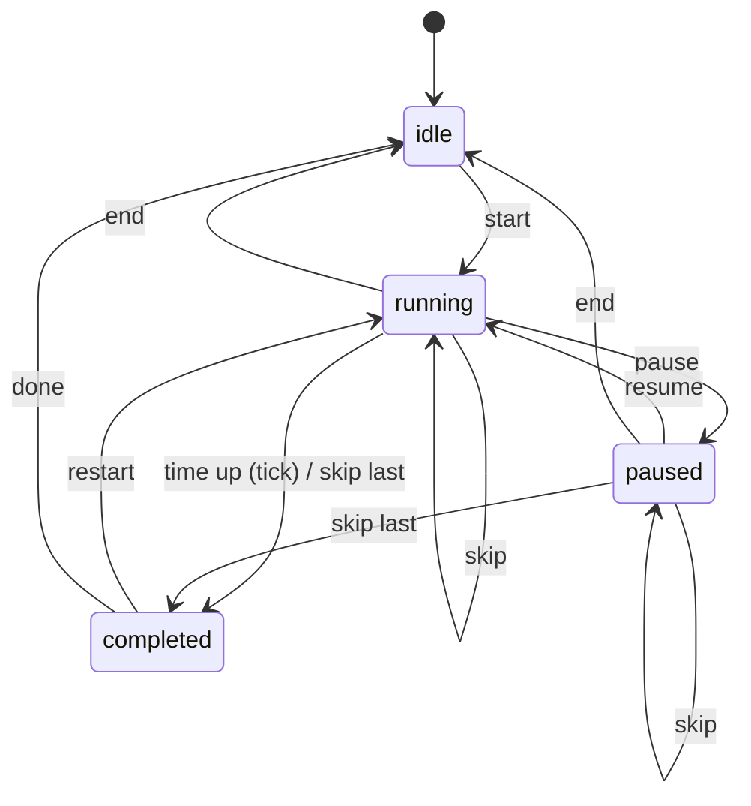

# RunWalk architecture

RunWalk is a local, single-user Couch-to-5K coach. YouTube plays music or podcasts as a separate app; RunWalk speaks interval cues over it, lowering (ducking) YouTube's volume while it speaks.

## 1. The constraint that shapes everything

Keeping the screen awake is easy. Keeping RunWalk **running** while YouTube is in the foreground is the hard part.

| Situation | What iOS does to RunWalk by default |
|---|---|
| RunWalk on screen | Runs normally. `expo-keep-awake` stops auto-lock. |
| YouTube in foreground or PiP | RunWalk is backgrounded and **suspended within seconds**. JS timers stop. No cues. |

`expo-keep-awake` does not help in the second row: it only affects the screen while RunWalk itself is in the foreground (expo-keep-awake turns itself off on background and back on when you return). While YouTube is playing video, YouTube is the one keeping the screen on.

So RunWalk needs a legitimate reason to stay alive in the background. Without GPS (out of scope), the only option on iOS is **background audio**: `UIBackgroundModes = audio` plus actually having audio output running. RunWalk runs a silent `AVAudioEngine` loop for the duration of a workout, in a session that mixes with others, so YouTube is never interrupted.

> App Store note: Apple can reject apps that play silence purely to stay alive. For a personal build installed via Xcode this is fine. If you ever publish, the defensible version is that the app is an audio coaching app that is actively producing spoken audio throughout the workout; expect review questions.

## 2. Layers



Dependency rule: arrows only point down. The core has no React, no Expo, no timers; it takes `now` as an argument. That is what makes it fully testable.

## 3. Timing engine

State is four numbers plus a status:

```
status: idle | running | paused | completed
startedAtMs, pausedAtMs, totalPausedMs, skippedMs
```

```
elapsed = (pausedAt ?? now) - startedAt - totalPaused + skipped     (clamped to [0, total])
```

Everything else (current interval, countdown, Up Next, remaining) is derived from `elapsed` and the cumulative interval offsets. There is no tick counter, so a late or missing tick cannot cause drift; the next computation just sees a later `now`.



**Skip** adds the current interval's remaining time to `skippedMs`. **Restart** goes straight to a fresh `running` state without passing through `idle` (so the idle handler does not tear down the audio session that start just created).

**Clock choice:** `Date.now()`. `performance.now()` is monotonic but on iOS is based on a clock that stops while the device sleeps, which is exactly the background case we care about. The tradeoff: if you change the phone's clock mid-run, the timer jumps. Acceptable for this app.

## 4. Announcer (no duplicate, no stale backlog)

`computeAnnouncements(session, progress, state)` is pure and returns `{cues, nextState}`. It remembers the highest interval index already announced.

- At most **one** interval cue per call, however many intervals passed.
- **Fresh** (interval began less than 4 s ago): speak the configured cue, e.g. "Walk for 90 seconds."
- **Stale** (we were suspended, or a phone call ran long): speak one resync cue, e.g. "Run. 40 seconds left."
- "Halfway there." is spoken once if fresh, silently dropped if stale. Spoken after the interval cue if both land on the same tick (this happens in Week 1).
- "Workout complete. Great job." is spoken once.

The hook calls this on every 250 ms tick and once immediately on `AppState -> active`.

## 5. Native audio module (`modules/runwalk-audio`)

A local Expo module rather than `expo-speech` + `expo-audio`, because ducking correctly needs one owner of the audio session that also knows exactly when speech ends.

### iOS sequence

```
startSession:  category .playback, options [.mixWithOthers]; setActive(true); start silent engine
speak(text):   pause engine; setActive(false); category .playback/.voicePrompt, [.duckOthers]; setActive(true); resume engine; speak
didFinish:     wait 350 ms (merges back-to-back cues); pause engine;
               setActive(false, .notifyOthersOnDeactivation)   <- this is what restores YouTube's volume
               category [.mixWithOthers]; setActive(true); resume engine
stopSession:   stop engine; setActive(false, .notifyOthersOnDeactivation)
```

iOS only applies and removes ducking on activation changes, which is why every duck and unduck re-activates the session. The engine pause is a few milliseconds, nowhere near long enough for iOS to suspend the app.

Also handled: interruptions (phone call, Siri) restart the session when they end; route changes (AirPods connect) restart the silent engine; a media-services reset rebuilds the session; a 15 s timeout guarantees unduck even if the synthesizer never calls back.

### Android

`TextToSpeech` with `USAGE_ASSISTANCE_NAVIGATION_GUIDANCE`, and `AUDIOFOCUS_GAIN_TRANSIENT_MAY_DUCK` requested before speaking and abandoned 350 ms after the last utterance. YouTube ducks or the system auto-ducks it.

### Android gaps (deliberate, iOS first)

Android can throttle or kill a backgrounded app. A production Android build needs a **foreground service** (type `mediaPlayback`, persistent notification) started in `startSession()` and stopped in `stopSession()`. The JS interface is already shaped for it, so adding it touches only Kotlin and `app.json` permissions (`FOREGROUND_SERVICE`, `FOREGROUND_SERVICE_MEDIA_PLAYBACK`, `POST_NOTIFICATIONS`).

## 6. Lifecycle summary

| Event | Keep-awake | Audio session | Cue |
|---|---|---|---|
| Start | on | start (awaited before first cue) | warm-up cue |
| Interval boundary | on | ducks for cue | interval cue |
| Switch to YouTube | iOS releases it; YouTube keeps screen on | stays alive (silent loop) | cues keep coming |
| Return to RunWalk | on again | unchanged | recompute; resync cue only if stale |
| Pause | off | stop | none |
| Resume | on | start (awaited) | none (current interval already announced) |
| Complete | off | stop after final cue finishes | "Workout complete" |
| End early | off | stop | none, not saved |

## 7. Storage

AsyncStorage key `runwalk.progress.v1`: `{ completed: { [sessionId]: ISO date } }`. Session ids (`w1-r1` ... `w9-r3`) are the contract; renaming them orphans saved progress. Fast Test completions save against the real session id on purpose, so the device checklist can verify saving. Use "Reset progress" afterwards.

## 8. Known limitations and risks

1. **Native code not yet compiled.** The Swift and Kotlin were written against the Expo SDK 58 module API in this project's `node_modules`, and autolinking resolves the module on both platforms, but the first Xcode build is the first compile. Expect possibly a small fix or two.
2. **YouTube background play / PiP needs YouTube Premium** in most regions. Without it, YouTube pauses when you leave it, regardless of RunWalk.
3. **Ducking depth is set by iOS**, not by the app. It is typically a noticeable but not dramatic drop.
4. **Silent Mode switch:** the `.playback` category ignores the ring/silent switch, so cues play even when the phone is on silent. This is intended.
5. **Fast Test Mode timing:** at 6 s per interval, Week 1 (18 intervals) takes about 1 min 48 s; Weeks 5 to 9 (3 intervals) take 18 s. Getting Week 1 under a minute would need about 3 s intervals, shorter than most cues. Use a later week when you want a sub-minute pass.
